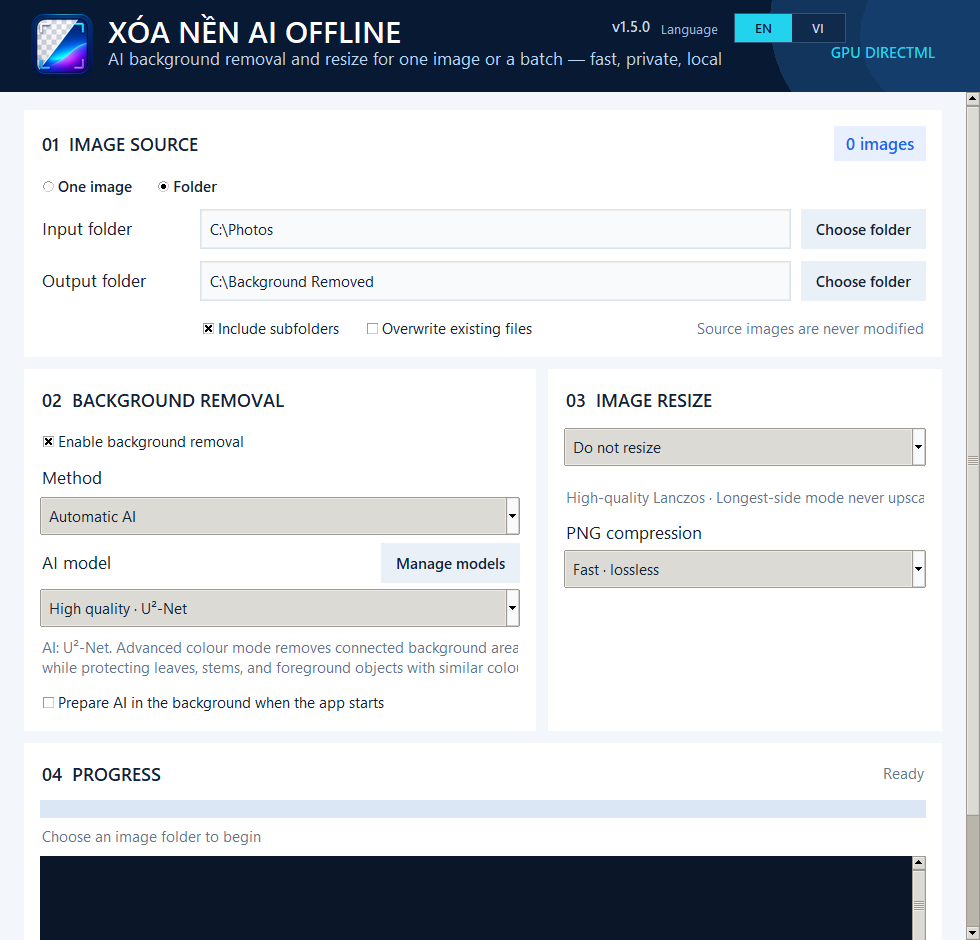

# Xóa Nền AI Offline

[English](README.md) · **Tiếng Việt**

Xóa Nền AI Offline là ứng dụng desktop Windows để xóa nền AI, tách nền theo
màu nâng cao, xử lý hàng loạt và resize ảnh. Ảnh chỉ được xử lý trên máy của
người dùng, không tải lên dịch vụ bên ngoài.

> **Trạng thái:** dự án đang được phát triển tích cực. Giao diện hiện tại dùng
> tiếng Việt; bản địa hóa tiếng Anh đang nằm trong roadmap.



## Tính năng

- Xử lý một ảnh hoặc cả folder và giữ nguyên cấu trúc folder con.
- Ba chiến lược xóa nền: AI tự động, theo màu nâng cao và Hybrid AI + màu.
- Nhiều mẫu nền, overlay mask, cọ Giữ lại/Xóa thêm, Undo/Redo 20 lệnh.
- Giao diện AI mặc định gọn; bộ điều khiển màu chỉ mở ở chế độ Theo màu/Hybrid
  và hiển thị ô màu trực quan cạnh mã hex của từng mẫu.
- Resize theo phần trăm, khung W × H hoặc giới hạn cạnh dài.
- Preload AI trong background, cancellation, back-pressure và atomic save.
- Ưu tiên TensorRT/CUDA → CUDA → DirectML → CPU và fallback an toàn.
- Chạy hoàn toàn offline sau lần cài đặt model đầu tiên.

## Kiến trúc

```text
Giao diện desktop
    │
    ▼
BatchImageService
    │
    ├── AI tự động ─────────┐
    ├── Theo màu nâng cao ──┼──► bounded pipeline ─► atomic PNG output
    └── Hybrid AI + màu ────┘
             │
             ▼
InferenceBackendManager
    └── TensorRT/CUDA → CUDA → DirectML → CPU
```

Pipeline giới hạn tối đa bốn ảnh full-resolution đang xử lý và chỉ giữ một ONNX
session tại một thời điểm. GPU inference được serialize để không nhân bản model
hoặc VRAM.

## Chạy từ source

Yêu cầu Windows 10 trở lên và Python 3.10 hoặc 3.11 64-bit.

```powershell
git clone https://github.com/Duongmike/Offline-Background-Remover.git
cd Offline-Background-Remover
setup.bat
run.bat
```

`setup.bat` tạo `.venv`, cài dependencies, tải model U²-Net và kiểm tra SHA256.
Sau khi setup xong, app không cần Internet để xử lý ảnh.

## Test và build

```powershell
.venv\Scripts\python.exe -m unittest discover -s tests -v
build.bat
build_installer.bat
```

Binary sinh ra không được commit vào Git. Installer chính thức và file checksum
sẽ được phát hành tại [GitHub Releases](https://github.com/Duongmike/Offline-Background-Remover/releases).

Maintainer có thể chạy workflow Release thủ công để dry-run build mà không phát
hành. Khi push tag `vMAJOR.MINOR.PATCH`, workflow chỉ tạo GitHub Release nếu tag
khớp phiên bản canonical, toàn bộ test đạt, packaged self-test, UI smoke test,
installer build và kiểm tra checksum đều thành công.

## Benchmark

```powershell
.venv\Scripts\python.exe -m image_tool.benchmark --model u2net --repeats 3 --output benchmarks\after_local.json
```

Xem phương pháp đo, environment, stage timings và giới hạn của kết quả tại
[báo cáo benchmark](benchmarks/BENCHMARK_REPORT_1.4.0.md). Dự án không tuyên bố
phần trăm chất lượng khi chưa có bộ dữ liệu ground-truth được gắn nhãn.

## Roadmap

- [ ] Giao diện tiếng Anh và tiếng Việt, lưu lựa chọn ngôn ngữ
- [x] Quy trình phát hành theo tag có thể tái tạo
- [ ] Bộ dữ liệu regression chất lượng ảnh lớn hơn
- [ ] Benchmark trên nhiều GPU và phần cứng hơn
- [ ] Điểm mở rộng rõ ràng cho removal backend mới

## Đóng góp

Bug report, tài liệu, test, bản dịch, benchmark và pull request có phạm vi rõ
ràng đều được chào đón. Đọc [CONTRIBUTING.md](CONTRIBUTING.md) trước khi bắt đầu.
Lỗ hổng bảo mật cần được báo cáo riêng theo [SECURITY.md](SECURITY.md).

Source của ứng dụng dùng [MIT License](LICENSE). Model và dependencies giữ
license riêng; xem [THIRD_PARTY_NOTICES.md](THIRD_PARTY_NOTICES.md).
